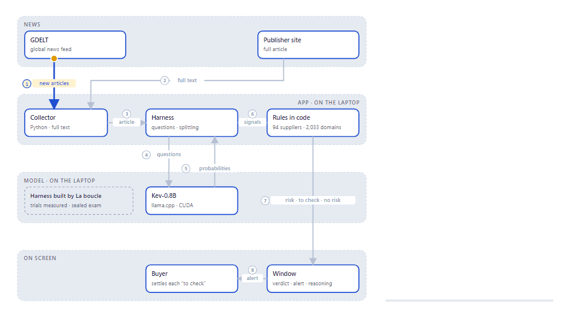
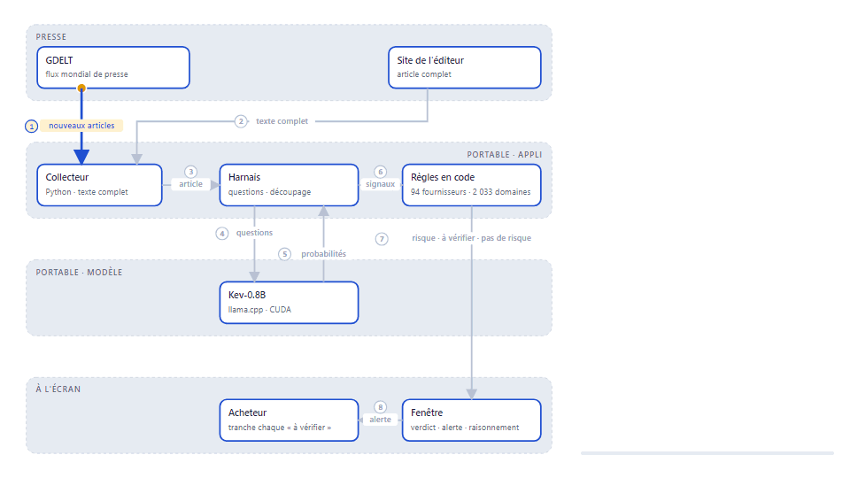

[English](README.md) · **Français**

# Agent risque fournisseur

**Un modèle de 0,8 milliard de paramètres, sur un ordinateur portable, lit la presse et signale les articles qui annoncent un risque pour un fournisseur d'un client.**

Version française

*Le trajet d'un article, puis les mesures du banc. [Vidéo complète (1:18)](https://drive.google.com/file/d/1ZEsKjU1clbmwX1BLNVl4TCTNQoqhprr7/view)*

## Ce qu'on fait avec

- **Suivre une liste de fournisseurs.** 94 fournisseurs d'un cas client ; les articles viennent du flux de presse GDELT et sont lus en entier sur le site de l'éditeur.
- **Trois verdicts.** Risque, à vérifier, pas de risque. Un signal = un fournisseur de la liste touché par un événement encore en cours, parmi six types : production, travail, légal, financier, prix ou pénurie, cyber.
- **Sources vérifiées par le code.** Un signal devient un risque seulement si le site figure dans une liste fermée de 2 033 domaines fiables ; sinon un humain tranche.
- **Modèle inchangé.** Les poids de Kev-0.8B ne sont jamais modifiés. [La boucle](https://github.com/anthohunt/la-boucle-engine) améliore seulement le harnais autour (questions posées, découpage, règles) : un agent chercheur propose des essais, chacun est mesuré, un examen scellé décide.
- **Appli Windows.** Un `.exe` autonome en anglais : les articles avec leur verdict, une alerte sur un risque, le raisonnement de l'agent.

## Architecture

Diagramme en français

## État

- **Banc.** Équilibré entre les trois verdicts : examen scellé de 240 articles, vérification de 240 ; seuil de 224 / 240 sur les deux.
- **Mesuré.** Sur 1 020 articles d'entraînement : 76,18 % de décisions justes pour le modèle seul, 90,39 % (922) avec le meilleur harnais, environ 88 % sur les 702 articles qu'il n'avait jamais vus.
- **Examen 1.** 205 / 240 (85,4 %), sous le seuil : sur-ajustement aux articles d'entraînement, d'où un lot de contrôle caché.
- **Appli.** Elle fait tourner le harnais de l'examen 1. 2,57 Go en tout (modèle 1,52, moteur 0,94, appli 0,11) ; mêmes décisions que le banc sur 100 / 100 articles ; 3,97 s par article en moyenne, carte graphique partagée avec le banc.
- **En pause depuis octobre 2026.** Examen 2 non passé. Code, données et appli sont un livrable client confidentiel : ce dépôt ne contient que cette page.
- **Pile.** Kev-0.8B (modèle de décision open source construit sur Qwen3.5-0.8B), Python, PyTorch et transformers sur le banc, llama.cpp (CUDA) dans l'appli, PyInstaller.

---

**Anthony Hunt** · [ingevision.cloud](https://ingevision.cloud/?p=risque-fournisseur) · [LinkedIn](https://www.linkedin.com/in/anthony-hunt-3948a9196) · [GitHub](https://github.com/anthohunt)
