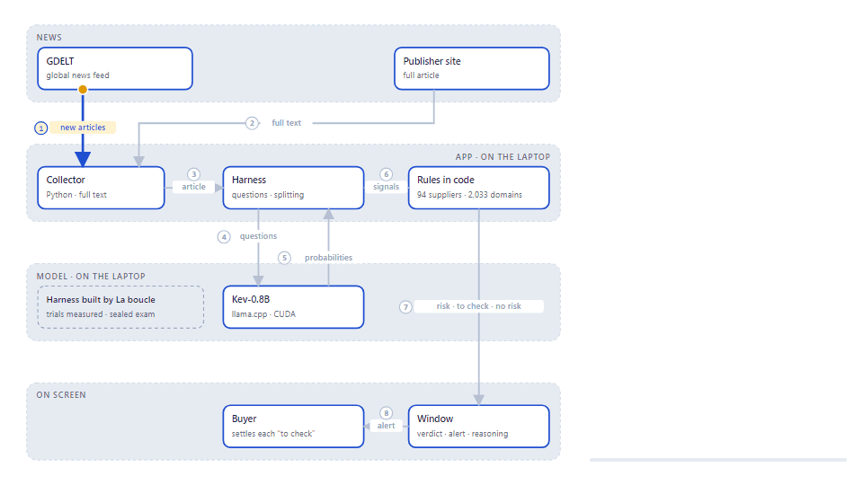
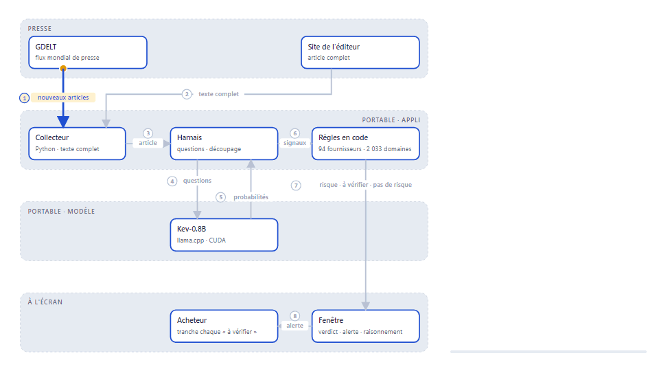

**English** · [Français](README.fr.md)

# Supplier risk agent

**A 0.8-billion-parameter model, run on a laptop, reads the news and flags the articles that announce a risk for one of a client's suppliers.**

French version

*One article's path, then the bench's measurements.*

## Using it

- **Watch a supplier list.** 94 suppliers from a client case; articles come from the GDELT news feed and are read in full on the publisher's site.
- **Three verdicts.** Risk, to check, no risk. A signal is a listed supplier hit by an event still under way, among six types: production, labour, legal, financial, price or shortage, cyber.
- **Sources checked by code.** A signal becomes a risk only if the site is in a closed list of 2,033 reliable domains; otherwise a person decides.
- **Model left as is.** Kev-0.8B's weights are never changed. [La boucle](https://github.com/anthohunt/la-boucle-engine) improves only the harness around it (questions, splitting, rules): a researcher agent proposes trials, each is measured, a sealed exam decides.
- **Windows app.** A standalone `.exe` in English: articles with their verdict, an alert on a risk, the agent's reasoning.

## Architecture

French version

## Status

- **Bench.** Balanced across the three verdicts: sealed exam of 240 articles, verification of 240; pass mark 224 / 240 on both.
- **Measured.** On 1,020 training articles: 76.18 % correct decisions for the model alone, 90.39 % (922) with the best harness, about 88 % on the 702 articles it had never seen.
- **Exam 1.** 205 / 240 (85.4 %), below the pass mark: overfitting to the training articles, hence a hidden control set.
- **App.** Runs the harness that sat exam 1. 2.57 GB in all (model 1.52, engine 0.94, app 0.11); same decisions as the bench on 100 / 100 articles; 3.97 s per article on average, GPU shared with the bench.
- **Paused since October 2026.** Exam 2 not taken. Code, data and app are a confidential client deliverable: this repository holds only this page.
- **Stack.** Kev-0.8B (open-source decision model built on Qwen3.5-0.8B), Python, PyTorch and transformers on the bench, llama.cpp (CUDA) in the app, PyInstaller.

---

**Anthony Hunt** · [ingevision.cloud](https://ingevision.cloud/?lang=en&p=risque-fournisseur) · [LinkedIn](https://www.linkedin.com/in/anthony-hunt-3948a9196) · [GitHub](https://github.com/anthohunt)
